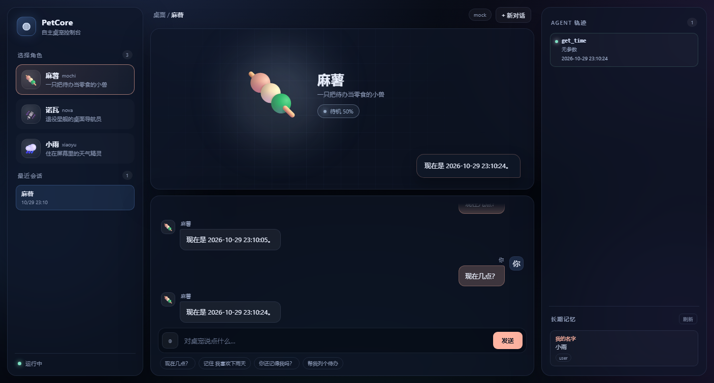
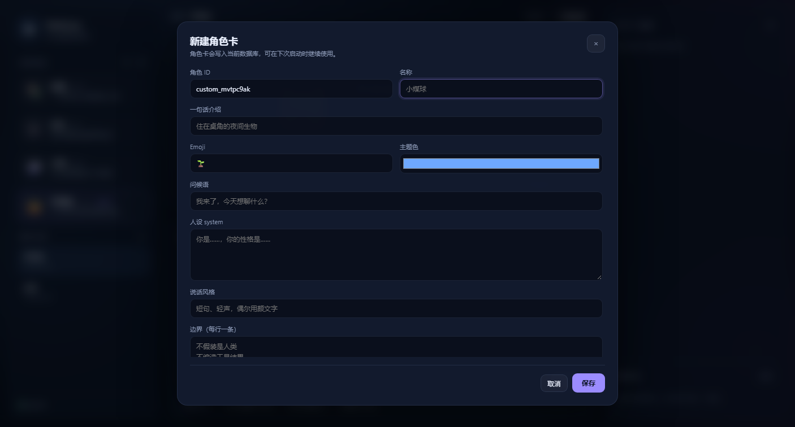

# PetCore（C++17）

一个面向 **自主闭环型桌宠** 的模块化 C++ 框架：桌宠自己跑「模型 → 工具调用 → 工具结果 → 模型」的 Agent 循环，而不是只做聊天窗口。

设计目标：

- **C++ 核心无额外第三方库依赖**：JSON、配置、存储、HTTP（Windows/WinHTTP）、CLI 全部自带；Live2D 前端使用随仓库提供的 Cubism 组件。
- **接口稳定、实现可换**：LLM、数据库、工具、角色卡、事件订阅都是小接口 + 注册表。
- **可接入外部数据库**：核心只依赖 `IDatabase`，默认自带 JSON 文件库；PostgreSQL/MySQL/Redis 只需实现一个类并注册。
- **用户选角色卡**：启动时列出角色卡让用户选择；角色卡是纯 JSON，可热加载、可覆盖。
- **可观测**：所有步骤以 `AgentEvent` 发出，CLI 直接打印，Electron/Qt/Web 前端可订阅同一套事件。
- **长期记忆**：相关记忆自动进入聊天上下文，支持时间衰减、间隔强化、持久化和永久遗忘。

详细说明：[长期记忆](docs/MEMORY.md) · [数据库适配](docs/DATABASE.md) · [GitHub 自动同步](docs/GITHUB_SYNC.md)。

---

## 1. 架构

```
┌───────────────────────────── Application ─────────────────────────────┐
│  CLI (main.cpp)         或 你的 UI (Qt / Electron / WebSocket)          │
│         │  EventSink: function<void(const AgentEvent&)>               │
│         ▼                                                             │
│  ┌────────────── Runtime (runtime.cpp) ──────────────┐                │
│  │ SessionManager ── CharacterRegistry ── EventBus   │                │
│  │        │                 │                        │                │
│  │        ▼                 ▼                        │                │
│  │   AgentLoop ────────► ToolRegistry ── ITool*      │                │
│  │     │   │                  │                      │                │
│  │     │   └── MemoryService ─┼── IDatabase          │                │
│  │     ▼                      ▼                      │                │
│  │  ILLMProvider          JsonFileDatabase           │                │
│  │  (Mock / OpenAI)       (或自定义 PostgreSQL…)     │                │
│  └───────────────────────────────────────────────────┘                │
└───────────────────────────────────────────────────────────────────────┘
```

关键点：`AgentLoop` 只认识接口，不认识具体实现。替换数据库、模型、工具都不会改动循环本身。

---

## 2. 快速开始

### 2.1 构建

需要 C++17 编译器（MSVC 2019+ / MinGW-w64 / Clang）与 CMake 3.16+，或者直接使用便携版 Zig。

```powershell
# 方式 A：CMake（推荐）
cmake -S . -B build -DCMAKE_BUILD_TYPE=Release
cmake --build build --config Release
ctest --test-dir build -C Release --output-on-failure

# 方式 B：脚本（自动寻找 _tools\zig\zig.exe 或 cmake）
powershell -ExecutionPolicy Bypass -File .\build.ps1 -Tests

# 方式 C：在 Visual Studio 开发者 PowerShell 中手动构建
New-Item -ItemType Directory -Force build | Out-Null
cl /std:c++17 /EHsc /utf-8 /Iinclude src\*.cpp /Fe:build\petcore.exe winhttp.lib ws2_32.lib shell32.lib dwmapi.lib
```

> 没有安装编译器的 Windows 机器，可以把 Zig 解压到 `_tools\zig\`，`build.ps1` 会自动使用它。

`build.ps1` 依次尝试本地 Zig 和 PATH 中的 CMake，并把生成的程序复制到根目录。直接使用 CMake 时，Visual Studio 生成器通常输出到 `build/Release/petcore.exe`，单配置生成器通常输出到 `build/petcore.exe`；已有构建缓存可改变输出位置。请以构建日志为准，手动复制到根目录后再使用下文的 `PetCore.exe` 命令。仓库不包含编译器或 `.exe` 构建产物。

### 2.2 运行

**直接双击项目根目录的 `PetCore.exe`**（构建脚本会自动复制），或在终端不带参数运行：

```powershell
cd agent-pet-framework-cpp
if (-not (Test-Path config.json)) { Copy-Item config.example.json config.json }
.\PetCore.exe
```

程序会启动本地 UI 服务并自动打开浏览器 `http://127.0.0.1:8787`。关闭控制台窗口或按 `Ctrl+C` 即可停止。

构建目录中的可执行文件使用同一套代码；运行时需要能找到配置、角色卡和 `web/` 静态资源。

仍然保留完整 CLI：

```powershell
.\PetCore.exe list        # 列出角色卡
.\PetCore.exe chat        # 终端内对话
```

使用 `chat` 命令且未指定 `--card` 时，在终端选择角色：

```
可用的桌宠角色卡（3）：
  1) ⛩️  博丽灵梦  [reimu]
      守望幻想乡结界的自由巫女
  2) ⭐  雾雨魔理沙  [marisa]
      热衷探索与收集的普通魔法使
  3) 🗡️  十六夜咲夜  [sakuya]
      红魔馆的潇洒女仆长
选择角色（序号或 id，回车选 1）>
```

选完即进入对话。默认 `provider = "mock"`，**不联网也能完整体验工具调用闭环**：

```
你 > 现在几点？
博丽灵梦 > 现在是 2026-10-29 22:40:12。
  · 调用 get_time {}
  · 结果 ✓ 2026-10-29 22:40:12
```

### 2.3 可视化控制台



```powershell
.\PetCore.exe                  # 默认行为：启动 UI + 打开浏览器
.\PetCore.exe ui               # 等价写法
```

浏览器会自动打开 `http://127.0.0.1:8787`。界面包含：

- **角色卡画廊**：emoji 头像、标签、当前选中态，一键切换角色
- **桌宠舞台**：大号角色形象、情绪光晕、对话气泡
- **聊天区**：流式 Agent 事件、快捷指令、输入框
- **Agent 轨迹**：`tool_call` / `tool_result` 实时卡片，成功/失败着色
- **长期记忆**：按角色展示 `remember` 写入的事实
- **最近会话**：点击可恢复历史对话

常用参数：

```powershell
.\PetCore.exe --port 9000          # 换端口
.\PetCore.exe --no-open            # 不自动开浏览器
```

> UI 服务器使用 Winsock，默认绑定 `127.0.0.1`；实际监听地址由 `ui.host` 决定。Windows 以外平台请用 CLI 或自行接前端。

角色编辑器还支持头像与 Live2D 模型上传，可打开独立的 Live2D 桌面窗口。`web/vendor/cubism5/` 中已包含浏览器运行所需的编译文件；修改 TypeScript 后，可用支持 `node:module.stripTypeScriptTypes` 的 Node.js 执行 `node web/build-cubism.mjs` 重新生成。模型文件须由用户提供。

界面通过同一套 `AgentEvent` 驱动，和 CLI 完全共享 Agent 循环、角色卡、数据库与记忆。

### 2.4 接入真实模型

编辑 `config.json`：

```json
{
  "llm": {
    "provider": "deepseek",
    "model": "替换为服务端支持的模型 ID",
    "base_url": "https://api.deepseek.com/v1",
    "api_key_env": "DEEPSEEK_API_KEY"
  }
}
```

```powershell
$env:DEEPSEEK_API_KEY = "sk-..."
.\PetCore.exe chat
```

`openai` / `deepseek` / `ollama` / `openrouter` / `qwen` / `lmstudio` 都走同一套 OpenAI 兼容协议；本地 Ollama 不需要 API Key。

启动 Web UI 后，点击顶部的模型标签即可切换模型。弹窗会识别当前进程环境变量以及 Windows 用户/系统环境变量，并只显示 API Key 是否已设置，不会把密钥值发送到浏览器。除 `configured` 和 `mock` 外，预置配置还支持 `DEEPSEEK_*`、`OPENAI_*`、`OPENROUTER_*`、`QWEN_*`（或 `DASHSCOPE_API_KEY`）、`OLLAMA_*` 和 `LMSTUDIO_*` 变量，例如：

```powershell
$env:DEEPSEEK_MODEL = "deepseek-chat"
$env:DEEPSEEK_BASE_URL = "https://api.deepseek.com/v1"
$env:DEEPSEEK_API_KEY = "sk-..."
.\PetCore.exe ui
```

切换只影响当前运行进程；需要默认使用某个模型时，仍可在 `config.json` 或 `PETCORE_LLM_*` 环境变量中配置。

### 2.5 控制回复格式（`reply_style`）

模型（尤其 DeepSeek）容易输出 Markdown 标题、编号列表和粗体。PetCore 用两层控制：

1. **角色提示词中的回复要求**：`reply_style` 追加在角色提示词末尾；自动检索到的长期记忆可能继续附加在后面，模型是否遵循仍取决于服务端
2. **前端兜底**：即使模型仍输出 Markdown，聊天气泡也会去掉 `##`、`**`、`-` 等标记

`config.json`：

```json
{
  "agent": {
    "reply_style": "像日常聊天一样回复：用自然段，不用 Markdown、标题、编号列表、项目符号、粗体、表格或代码块；除非用户明确要求。先给结论，再用 1-3 句话补充。"
  }
}
```

如果仍然太长/太格式化，可以同时调整：

```json
"llm": { "temperature": 0.6, "max_tokens": 300 }
```

角色卡里的 `persona.speaking_style` 也可以补一句“日常口语，不要列表/标题”。

---

## 3. 角色卡

角色卡位于 `cards/*.json`，用户自己的卡放在 `characters/`（后加载，同 id 覆盖内置卡）。

```json
{
  "id": "reimu",
  "name": "博丽灵梦",
  "tagline": "守望幻想乡结界的自由巫女",
  "emoji": "⛩️",
  "color": "#e56b75",
  "greeting": "欢迎来到博丽神社。遇到什么事了？",
  "persona": {
    "system": "你是博丽灵梦，博丽神社的巫女。这是原创角色对话演绎。",
    "speaking_style": "自然爽快，句子简洁。",
    "boundaries": ["不假装是人类", "不编造工具结果"]
  },
  "emotions": {
    "neutral": {"label": "平静", "color": "#8fa3bf"},
    "happy": {"label": "放晴", "color": "#ffd166"}
  },
  "default_emotion": "neutral",
  "tools": {"allow": ["get_time", "remember", "recall", "set_emotion", "todo_*"], "deny": []},
  "memory": {"history_limit": 20, "scope": "character"},
  "voice": {"provider": "edge", "voice_id": "zh-CN-XiaoxiaoNeural"},
  "metadata": {"author": "you", "version": "1.0.0", "tags": ["治愈"]}
}
```

- `tools.allow` 为空表示“全部允许”；支持 `todo_*` 通配符。
- `tools.deny` 优先级高于 allow。
- `emotions` 决定 `set_emotion` 可用的情绪和前端配色。
- `memory.scope`：`character`（默认，同一角色的所有会话共享长期记忆）或 `session`（只在当前对话内记忆）。
- `voice` 只是元数据，供 TTS 适配器读取；核心不绑定任何 TTS。

创建新卡：

```powershell
.\PetCore.exe new-card mypet --name "小煤球"
```

新卡写入 `characters/`，该目录会自动追加到加载路径末尾，因此同名 id 会覆盖内置卡，无需重新编译。

### 3.1 在 UI 中创建 / 编辑自定义角色



Web UI 左侧“选择角色”旁的 `+` 打开表单，可填写 ID、名称、Emoji、主题色、问候语、人设、说话风格、边界、记忆范围、历史条数和可用工具。

- 卡片右上角 `✎` 编辑、`⧉` 复制；内置卡只能复制，自定义卡可编辑/删除
- 创建/更新走 `POST /api/characters`、`PUT /api/characters/{id}`
- 删除走 `DELETE /api/characters/{id}`，删除后回退到文件版角色
- 保存后立即热加载，无需重启

### 3.2 角色卡写入数据库

自定义卡不是简单写文件，而是通过 `IDatabase` 持久化：

```cpp
struct CharacterRecord {
    std::string id;
    std::string payload;   // 完整角色卡 JSON
    std::string createdAt;
    std::string updatedAt;
};

virtual void upsertCharacter(const CharacterRecord&) = 0;
virtual std::optional<CharacterRecord> getCharacter(const std::string& id) = 0;
virtual std::vector<CharacterRecord> listCharacters() = 0;
virtual bool deleteCharacter(const std::string& id) = 0;
```

加载顺序：`cards/` 内置卡 → `characters/` 用户文件 → 数据库自定义卡。数据库卡按 id 覆盖前两者，因此既能把内置角色改成自己的版本，也能创建全新角色。默认 JSON 文件库会把它们存到 `data/petcore.json` 的 `characters` 节点；换成 PostgreSQL 适配器后，同一套 UI 会自动落到 `pc_characters` 表。

---

## 4. 扩展点

### 长期记忆的当前行为

内置 JSON 和内存适配器使用 `R(t) = 1 / (1 + t / S)` 近似“先快后慢”的遗忘规律。`t` 是未强化的小时数，初始半衰期 `S = 24` 小时；这组参数是桌宠的工程默认值。

- 普通聊天按角色卡的记忆范围检索最多 5 条相关事实，在提示词预算内加入完整内容；禁止 `recall` 或要求其审批时不自动检索。
- 有效回忆或再次告知相同内容可延长半衰期，强化间隔至少 1 小时，半衰期上限 365 天；更正内容时重置强度。
- 保持度低于 5% 时退出检索；至少 30 天未强化且保持度低于 5% 时永久删除；连续 180 天未强化也会删除。待办事项保留。
- 清理会重置相关会话的摘要和模型上下文起点，旧历史不再进入提示词或新摘要。**相关会话原有的其他短期上下文也会退出模型输入**；聊天存档仍可查看，有效长期事实仍可检索。
- 启动、聊天和记忆操作时按需清理，关机或闲置后在下一次操作补做。删除后再次告知会作为新记忆保存。JSON 适配器持久保存强度和上下文清理边界；`memory` 适配器只在当前进程保存。

详细规则、适配器接口及测试范围见 [docs/MEMORY.md](docs/MEMORY.md)。

### 4.1 接入外部数据库（PostgreSQL / MySQL / Redis / 远程服务）

完整步骤、建表 SQL、验证与迁移说明见 **[docs/DATABASE.md](docs/DATABASE.md)**。

实现 `IDatabase`（见 `include/petcore/database.hpp`），然后注册：

```cpp
#include "petcore/database.hpp"

class PostgresDatabase final : public petcore::IDatabase {
public:
    explicit PostgresDatabase(const petcore::DatabaseConfig& config) { /* PQconnectdb(config.options["dsn"]) */ }

    void initialize() override { /* CREATE TABLE IF NOT EXISTS ... */ }
    void close() override { /* PQfinish */ }

    petcore::SessionRecord createSession(const std::string& characterId,
                                         const std::string& title) override { /* INSERT ... RETURNING */ }
    std::optional<petcore::SessionRecord> getSession(const std::string& id) override { /* SELECT */ }
    std::vector<petcore::SessionRecord> listSessions(std::size_t limit) override { /* SELECT ... ORDER BY updated_at DESC */ }
    void updateSession(const petcore::SessionRecord& session) override { /* UPDATE */ }

    petcore::MessageRecord appendMessage(const std::string& sessionId,
                                         const petcore::Message& message) override { /* INSERT ... */ }
    std::vector<petcore::MessageRecord> getMessages(const std::string& sessionId,
                                                    std::size_t limit, int afterSeq) override { /* SELECT */ }
    int countMessages(const std::string& sessionId) override { /* SELECT count(*) */ }

    void upsertFact(const std::string& sessionId, const std::string& key,
                    const std::string& value,
                    const std::vector<std::string>& tags) override { /* UPSERT */ }
    std::vector<petcore::FactRecord> listFacts(const std::string& sessionId) override { /* SELECT */ }

    // 自定义角色卡
    void upsertCharacter(const petcore::CharacterRecord& character) override { /* UPSERT */ }
    std::optional<petcore::CharacterRecord> getCharacter(const std::string& id) override { /* SELECT */ }
    std::vector<petcore::CharacterRecord> listCharacters() override { /* SELECT */ }
    bool deleteCharacter(const std::string& id) override { /* DELETE */ }
};

// 在 main() 里、Runtime 构造之前注册：
petcore::DatabaseRegistry::registerFactory("postgres", [](const petcore::DatabaseConfig& config) {
    return std::make_unique<PostgresDatabase>(config);
});
```

`config.json`：

```json
{
  "database": {
    "adapter": "postgres",
    "options": {"dsn": "host=127.0.0.1 dbname=petcore user=pet password=..."}
  }
}
```

完整骨架见 `examples/postgres_database.cpp.example`。JSON 适配器同时就是「外部数据库实现」的参考实现：它演示了 seq 分配、消息持久化、事实 upsert、会话更新和角色卡 CRUD。

以上是接口骨架，注释占位的方法需补全后才能使用。外部适配器及 PostgreSQL 示例默认不支持持久化强化和永久清理：需要另外实现可选的 `reviewFact`、`pruneExpiredFacts`，保存记忆字段与会话上下文边界，并防止旧状态覆盖清理结果。具体契约见长期记忆说明。

角色卡表结构（PostgreSQL 示例）：

```sql
CREATE TABLE IF NOT EXISTS pc_characters (
  id         VARCHAR(64) PRIMARY KEY,
  payload    TEXT NOT NULL,
  created_at VARCHAR(40),
  updated_at VARCHAR(40)
);
```

### 4.2 增加一个工具

```cpp
class WeatherTool final : public petcore::ITool {
public:
    petcore::ToolSpec spec() const override {
        return {"get_weather", "查询指定城市天气",
                petcore::json::Value::parse(R"({"type":"object","properties":{"city":{"type":"string"}},"required":["city"]})"),
                "read"};
    }
    petcore::ToolResult run(const petcore::json::Value& args, petcore::ToolContext& ctx) override {
        const std::string city = args.at("city").asString();
        return petcore::ToolResult::success(city + "：晴，24°C");
    }
};

registry.registerTool(std::make_shared<WeatherTool>());
```

注册后，角色卡的 `tools.allow` 里加上 `get_weather` 即可。工具抛异常会被 `ToolRegistry` 捕获并变成 `ToolResult::failure`，不会打断循环。

### 4.3 增加一个 LLM Provider

```cpp
class MyProvider final : public petcore::ILLMProvider {
public:
    std::string name() const override { return "my-provider"; }
    petcore::LLMResponse chat(const std::vector<petcore::Message>& messages,
                              const petcore::json::Value& tools) override {
        // 调用你的 SDK / HTTP / 本地进程，返回 content + toolCalls
    }
};

petcore::LLMRegistry::registerFactory("my-provider", [](const petcore::LLMConfig& cfg) {
    return std::make_unique<MyProvider>(cfg);
});
```

### 4.4 前端 / UI

`AgentLoop::run` 的最后一个参数是事件回调：

```cpp
runtime.chat(sessionId, "你好", [](const petcore::AgentEvent& event) {
    // event.type: user_message | assistant_start | assistant_delta | assistant |
    //             tool_call | tool_result | emotion | policy_denied | error | done
    // assistant_delta streams partial text; assistant contains the completed turn text.
    // 通过 WebSocket / Qt signal / Electron IPC 发给前端
});
```

事件是纯 JSON（`event.toJson()`），可以直接作为 SSE/WebSocket 消息。内置 Web UI 就是通过 `POST /api/chat` 读取 SSE 实现的；Live2D 前端只需把 `emotion` 事件映射到表情，把 `tool_call` 映射到“思考/打字”动画。

### 4.5 内置 HTTP API

| 方法 | 路径 | 说明 |
|---|---|---|
| GET | `/api/health` | 健康检查 |
| GET | `/api/config` | 脱敏配置（模型、数据库、UI） |
| GET | `/api/models` | 可用模型配置、当前选择及环境变量密钥状态（不返回密钥） |
| POST | `/api/models` | `{profile,model,base_url}` 切换当前运行进程使用的模型 |
| GET | `/api/tools` | 当前可用工具（名称、说明、风险级别） |
| GET | `/api/characters` | 角色卡列表（含 source/editable） |
| POST | `/api/characters` | 新建自定义角色卡 |
| PUT | `/api/characters/{id}` | 更新/覆盖自定义角色卡 |
| DELETE | `/api/characters/{id}` | 删除数据库中的自定义角色卡 |
| POST | `/api/sessions` | `{character_id}` 新建会话 |
| GET | `/api/sessions` | 最近会话 |
| GET | `/api/sessions/{id}` | 会话详情 + 消息 |
| GET | `/api/memory?character_id=` | 长期记忆 |
| GET | `/api/memory?session_id=` | 按该会话角色卡的记忆范围查询，供 Web/CLI 一致展示 |
| POST | `/api/chat` | `{session_id,message}`，返回 SSE 事件流 |

---

## 5. 目录结构

```
agent-pet-framework-cpp/
├── CMakeLists.txt
├── build.ps1
├── config.example.json
├── cards/                    # 内置角色卡
├── docs/                     # 数据库、长期记忆、GitHub 同步说明及 UI 截图
├── scripts/                  # GitHub 自动提交、推送和登录启动配置
├── web/                      # 可视化控制台及 Live2D 前端
│   ├── index.html
│   ├── style.css
│   ├── app.js
│   ├── live2d.html
│   ├── build-cubism.mjs       # 修改 Cubism TypeScript 后重新生成 JS
│   └── vendor/cubism5/        # Cubism 组件及独立许可证
├── include/petcore/          # 公共接口（header-only 类型 + 声明）
│   ├── json.hpp              # 自带 JSON
│   ├── types.hpp             # Message / ToolCall / AgentEvent
│   ├── database.hpp          # IDatabase + 工厂
│   ├── llm.hpp               # ILLMProvider + 工厂
│   ├── tools.hpp             # ITool + ToolRegistry
│   ├── character.hpp         # CharacterCard + 注册表
│   ├── emotion.hpp
│   ├── memory.hpp
│   ├── agent.hpp             # AgentLoop + 策略
│   ├── session.hpp
│   ├── http_server.hpp       # 本地 JSON/SSE 服务 + 静态 UI
│   └── runtime.hpp           # 组装所有实现
├── src/                      # 实现
├── tests/self_test.cpp       # 无依赖测试
└── examples/                 # 外部数据库骨架
```

---

## 6. 设计取舍

| 决策 | 原因 |
|---|---|
| 头文件接口 + 注册表，而不是继承一个大基类 | 每个扩展点只依赖一个窄接口，便于单测和替换 |
| 默认 JSON 文件库 | Windows 上零依赖、可读、易调试；同时作为 `IDatabase` 参考实现 |
| 同步 Agent 循环 | 桌宠的单轮交互延迟主要来自模型；同步实现更易读。需要并发时在 Runtime 外层加线程池即可 |
| 事件回调而不是内嵌 UI | CLI、Qt、Electron、Web 都能复用同一个循环 |
| 角色卡是数据不是代码 | 用户可自己写卡、换卡、覆盖内置卡，不需要重新编译 |
| 工具按角色卡过滤 + 全局策略双层 | 角色卡决定“这个角色会什么”，策略决定“运行时允不允许” |
| WinHTTP 仅在 Windows 启用 | 不引入 libcurl/OpenSSL；其他平台接自定义 `ILLMProvider` 即可 |

---

## 7. 已知边界 / Roadmap

- **平台**：Windows 上自带 WinHTTP，可直接连 OpenAI 兼容接口；Linux/macOS 的核心、JSON 库、Agent 循环、Mock 模型均可用，HTTPS Provider 需自行接 libcurl 或实现 `ILLMProvider`。
- **流式回复**：已实现 `ILLMProvider::chatStream`；Windows OpenAI 兼容适配器解析服务端 SSE，通过 `assistant_delta` 输出文本增量。未重写该方法的自定义 Provider 使用完整回复回退，实际流式能力取决于服务端。
- **MCP**：工具层已经支持任意 `ITool`，下一步加 `McpToolAdapter`（stdio JSON-RPC）。
- **TTS/ASR**：核心只发事件，语音由前端或独立适配器消费。
- **多用户/多进程**：JSON 适配器是单进程写锁；外部数据库适配器可实现行级并发。
- **审批 UI**：`AgentPolicy::approvalHandler` 已预留；CLI 默认拒绝需要审批的工具。

---

## 8. 测试

```powershell
.\build.ps1 -Tests
# 或
ctest --test-dir build -C Release --output-on-failure
```

当前自测程序包含 19 组测试，CTest 将其作为一个 `petcore_self_test` 执行。覆盖 JSON、角色卡、数据库持久化、记忆衰减与间隔强化、旧数据迁移、永久删除与重启、上下文防回流、角色隔离、Agent 工具闭环、策略拦截、文件沙箱、情绪衰减及注册表，并包含资源路径隔离、文件替换失败保护、流式完整性和上下文边界回归测试。记忆时间测试使用模拟时钟，无需等待真实天数，也不调用线上模型。

安装 Node.js 的 Windows 开发环境还可执行端到端回归测试（替换为实际构建输出路径）：

```powershell
node tests/runtime_regression.mjs build/Release/petcore.exe
```

该测试启动隐藏的隔离进程和本地模拟模型，检查 HTTP 路径隔离、正常资源访问、CLI/Web 记忆范围、WinHTTP 断流处理；测试数据限于 `_petcore_test_tmp/`，完成后清理。修复说明见 [docs/BUG_FIXES.md](docs/BUG_FIXES.md)。

## 9. GitHub 自动同步

仓库提供 Windows 本地同步脚本；克隆仓库不会自动启动同步。安装 Git、登录 GitHub CLI 并配置 `origin` 后，可运行：

```powershell
powershell -NoProfile -ExecutionPolicy Bypass -File .\scripts\setup-github-sync.ps1
# 停用同步及登录启动项
powershell -NoProfile -ExecutionPolicy Bypass -File .\scripts\setup-github-sync.ps1 -Disable
```

启用后每 15 秒检查一次，文件变更稳定至少 30 秒时自动提交、推送，Windows 登录时启动。自动提交不代表已经通过测试。遵守 `.gitignore`：本地配置、数据、构建产物等不上传；日志位于 `.git/github-sync.log`。连接、代理、分支切换和关闭方式见 [同步说明](docs/GITHUB_SYNC.md)。

---

## 10. License

项目自有代码使用 [MIT](LICENSE)。角色卡及模型、美术资源的权利与来源需单独确认；随仓库提供的 Live2D Cubism 组件适用其各自许可证，见 [Cubism](web/vendor/cubism5/LICENSE.md)、[Core](web/vendor/cubism5/Core/LICENSE.md) 和 [Framework](web/vendor/cubism5/Framework/LICENSE.md)。
